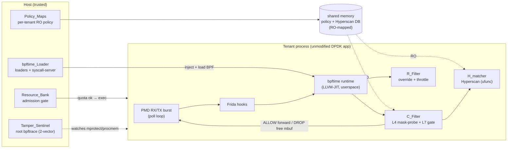

# eSAC — eBPF-enforced Security Access Control for Multi-Tenant DPDK

**eSAC** is an **in-process** security layer for multi-tenant **DPDK** deployments. From *inside an
unmodified DPDK tenant process* — and with **no kernel transition on the packet hot path** — it
enforces per-tenant network access control, resource limits, and the integrity of that enforcement
itself. eSAC is built **on**, not as a fork of, the userspace eBPF runtime
[**bpftime**](https://github.com/eunomia-bpf/bpftime).

---

## A. Project Overview

Kernel-bypass dataplanes (DPDK/SR-IOV) are the standard for NFV and high-performance cloud
networking: a single physical NIC (PF) is partitioned into virtual functions (VFs), one per
tenant, and each tenant polls its VF directly in userspace. **SR-IOV isolates each VF's own queues
and port — but it does not isolate three things that still matter for a shared host:**

1. **Who a tenant talks to on the wire.** There is no per-tenant L4/L7 access control on the
   bypass path. Kernel firewalls (netfilter, tc-eBPF) never see the traffic, and an external
   middlebox (e.g. a Suricata IDS) adds a forwarding hop and cannot inline into a tenant's
   poll-mode loop.
2. **Shared host/NIC resources.** The hugepage pool, the host allocator, and the NIC's shared
   eSwitch flow-table / firmware steering are *not* partitioned by SR-IOV. One tenant can starve
   its neighbours by **holding** a shared resource or by **churning** a shared control API.
3. **The enforcement's own integrity.** A tenant owns its address space; any in-process guard it
   can reach, it can try to peel off.

**Approach.** eSAC injects the **bpftime** userspace-eBPF runtime into the unmodified tenant.
Frida installs hooks on the PMD's RX/TX **burst** functions and on the relevant `rte_*` resource
APIs; eSAC's eBPF policy programs run on bpftime's **LLVM-JIT in userspace, next to the DPDK poll
loop**, so the packet hot path never traps into the kernel. On top of this runtime eSAC implements
**three planes** — Communication, Resource, Integrity.

**Key technical contributions.**
- **In-process L4/L7 access control on the DPDK fast path** — a 5-tuple L4 lookup whose cost is
  **independent of the policy count**, and **byte-bound** L7 inspection (DNS QNAME / application
  verb) via batched Hyperscan, including **selective per-packet DROP** that keeps the tenant running.
- **Resource control for the SR-IOV blind spots** — admission screening, runtime API-return
  override, and a token-bucket **churn** throttle, defending both the *hold* and the *rate* attack.
- **Tamper-resistant enforcement** — read-only policy/code mappings, a root-owned tamper sentinel,
  and a fail-closed STOP/CONT start gate so no packet ever flows un-enforced.

---

## B. System Architecture

```
Host (trusted)                                  Tenant process (untrusted, unmodified DPDK app)
──────────────                                  ───────────────────────────────────────────────
Resource_Bank   admission gate (pre-exec)       ┌───────────────────────────────────────────┐
bpftime_Loader  inject agent + load BPF/policy  │  DPDK PMD poll loop (RX/TX burst)           │
Policy_Maps     per-tenant RO policy -> shm     │    │  Frida hooks (bpftime_Agent/Frida)     │
Tamper_Sentinel root bpftrace (2-vector)        │    ▼                                        │
                                                │  bpftime runtime (LLVM-JIT, userspace)      │
   shared memory  <───── policy / Hyperscan DB ─┤    ├─ C_Filter   L4 5-tuple + L7 gate        │
   (RO-mapped)                                  │    ├─ H_matcher  L7 Hyperscan (ufunc)        │
                                                │    └─ R_Filter   resource override + throttle│
                                                └───────────────────────────────────────────┘
```



- **Host ↔ Tenant.** The host screens, launches, and gates each tenant; it loads policy into
  shared memory, injects the bpftime agent, and runs the (root) tamper sentinel off the tenant's
  path. The tenant is an *unmodified* DPDK application.
- **DPDK datapath.** Enforcement runs on the PMD's RX/TX **burst** function — the busiest point of
  the poll loop — so every packet a tenant sends or receives is inspected without leaving userspace.
- **Policy + shared memory.** Per-tenant policy (L4 5-tuple table, resource quotas) and the L7
  Hyperscan match databases live in shared memory, **read-only** mapped into the tenant.

---

## C. Components

Directory layout (component names are stable and load-bearing — loaders resolve BPF
program/section and map names by string):

| Component | Side | Role | Source |
|---|---|---|---|
| **bpftime_Loader** | host | all host loaders (`c_loader`, `c_loader_rx`, `r_loader`, `r_loader_rate`) + the bpftime syscall-server; inject the agent, load the BPF programs and policy, auto-discover PMD symbols | `bpftime_Loader/src/` |
| **bpftime_Agent / Frida** | tenant | installs the PMD RX/TX burst hooks and the `rte_*` uprobes (bpftime's Frida-Gum backend) | injected runtime |
| **bpftime_Agent / C_Filter** | tenant | communication plane eBPF: **L4** 5-tuple policy via a mask-probe hash (`c_filter.bpf.c`) and the **L7 gate** (`c_filter_hs_gate.bpf.c`) | `bpftime_Agent/C_Filter/` |
| **bpftime_Agent / H_matcher** | tenant | L7 matcher: raw / full DNS-aware Hyperscan scan (`src/esac_hs_ufunc.c`) and the DNS-aware selective-DROP provider (`src/esac_suricata_dns_ufunc.c`); plus the RO match-DB builders (`hsdb_ctl/`), patterns and payloads | `bpftime_Agent/H_matcher/` |
| **bpftime_Agent / R_Filter** | tenant | resource plane eBPF: API-return **override** (`r_filter.bpf.c`), **quota** (`r_filter_quota.bpf.c`), and token-bucket **rate/churn throttle** (`r_filter_rate.bpf.c`) | `bpftime_Agent/R_Filter/` |
| **Policy_Maps** | host | per-tenant read-only policy generation (`gen_policy_n.py`, …) loaded into shared memory | `Policy_Maps/` |
| **Resource_Bank** | host | pre-exec resource admission gate (`esac_admit.sh`) | `Resource_Bank/` |
| **Tamper_Sentinel** | host | root `bpftrace`, 2-vector (`mprotect(PROT_WRITE)`, `openat /proc/self/mem`) → `SIGKILL`; canonical script `tamper_sentinel_event.sh` | `Tamper_Sentinel/` |

**Relationships.** Host loaders under `bpftime_Loader` inject the agent and load each plane's BPF;
the BPF program each loader injects lives under the Agent module that runs it (`C_Filter`,
`R_Filter`). The L7 gate in `C_Filter` calls into `H_matcher` through a bpftime **ufunc**
(`esac_hs_scan`). Policy and admission stay with their plane (`Policy_Maps`, `Resource_Bank`).
Upstream components (bpftime, Frida-Gum, Hyperscan, DPDK, libbpf) and their versions/licenses are
listed in **[ATTRIBUTION.md](ATTRIBUTION.md)**.

### The three planes

- **Communication control — *who a tenant may talk to.*** Per-tenant **L4** (5-tuple) and **L7**
  (DNS QNAME, application verb) policy on the datapath, actions **ALLOW / DROP**. L4 uses a
  mask-probe hash keyed by `cgroup_id` whose cost is **independent of the policy count**. L7
  content-prescans each burst and hands candidate payloads to `H_matcher`, which for DNS parses the
  QNAME out of the wire format and matches it **case-insensitively, anchored to label boundaries**
  (`(^|\.)domain$`) against a Hyperscan DB. Matching malicious packets can be **dropped
  individually** while benign traffic in the same burst is forwarded and the tenant keeps running.
- **Resource control — *what a tenant may consume.*** Guards the PF-shared NIC and host resources
  SR-IOV does not isolate. **Admission** refuses to exec an over-quota tenant; **runtime override**
  rewrites an over-quota `rte_malloc`/`rte_flow_create`/… return to a failure value for the
  offender only; a **token-bucket throttle** bounds the *rate* of shared control-API churn
  (`rte_flow_create/destroy`, `rte_malloc`/`rte_free`). Termination is only a backstop.
- **Integrity — *keeping the enforcement un-removable.*** The patched burst prologue, the JIT
  pages, and the entire per-tenant policy table (Hyperscan DB included) are `mprotect`'d read-only
  after install. The only two syscalls that can restore write access —
  `mprotect(PROT_WRITE)` and `openat("/proc/self/mem")` — are watched by a **root-owned** sentinel
  that `SIGKILL`s the tenant on attempt. Cross-process tampering also fails
  (`process_vm_writev` → `EFAULT`, `/dev/mem` root-only, `ptrace` gated by `yama`).

---

## D. Execution Flow

1. **Admission** (`Resource_Bank`). Before EAL starts, the host screens the tenant's requested
   lcores / mempools / memory against its quota. Over-quota ⇒ the process is **never exec'd**.
2. **Start gate — hold stopped.** The tenant is launched held **`SIGSTOP`** *before* its EAL/PMD
   begins polling, so there is no un-enforced window.
3. **Inject + load** (`bpftime_Loader`). The loader injects the bpftime **agent** into the stopped
   tenant and loads the `C_Filter` / `R_Filter` BPF into shared memory via the syscall-server. The
   agent registers its ufuncs — `esac_hs_scan` (the matcher) and `rte_pktmbuf_free_bulk` (mbuf
   bulk-free, used by selective DROP) — and Frida installs the PMD RX/TX hooks and `rte_*` uprobes.
4. **Policy load** (`Policy_Maps`). The per-tenant policy and the Hyperscan match DBs are placed in
   shared memory and **RO-mapped** into the tenant.
5. **Integrity arm** (`Tamper_Sentinel`). RO mappings are applied and the root bpftrace sentinel is
   watching the two tamper vectors.
6. **Release — `SIGCONT`.** The tenant resumes; packets begin to flow, now fully enforced.
7. **Inspect + enforce (per burst).** Each RX/TX burst hook runs `C_Filter` L4 (mask-probe hash),
   then — for inspectable payloads — the L7 gate prescans and calls `H_matcher`. The verdict is
   **ALLOW** (forward) or **DROP** (free the mbuf). In parallel, `R_Filter` guards the resource
   APIs (override / throttle).

---

## E. Build and Usage

Full details are in **[BUILD.md](BUILD.md)** and **[RUN.md](RUN.md)**; a summary:

**Dependencies.** DPDK 22.11+ (with your NIC's PMD), libbpf/libelf/zlib, clang/LLVM 14 (for the
eBPF objects), Hyperscan (`-lhs`), bpftrace, and the **bpftime** runtime built from source
(LLVM 15 + Frida backend) with the eSAC patch applied.

**1. Build the bpftime runtime with the eSAC patch** (the runtime `.so`s are not vendored — they
exceed GitHub's file-size limit; see **[bpftime-patch/](bpftime-patch/)**):

```sh
git clone --recursive https://github.com/eunomia-bpf/bpftime && cd bpftime
git checkout edcc8ec
git apply /path/to/eSAC/bpftime-patch/esac-bpftime-edcc8ec.patch
cmake -S . -B build -DCMAKE_BUILD_TYPE=Release \
  -DLLVM_DIR=/usr/lib/llvm-15/lib/cmake/llvm \
  -DBPFTIME_ENABLE_FRIDA=ON -DBPFTIME_BUILD_WITH_LIBBPF=ON
make -C build bpftime-agent bpftime-syscall-server -j
# install the agent + syscall-server .so per BUILD.md §2
```

**2. Build eSAC** (loaders, eBPF objects, H_matcher, DB tools) — see BUILD.md §3–§5, e.g.:

```sh
gcc bpftime_Loader/src/c_loader.c -o bpftime_Loader/c_loader -lbpf -lelf -lz
clang -O2 -g -target bpf -D__TARGET_ARCH_x86 -I bpftime_Agent/C_Filter \
  -c bpftime_Agent/C_Filter/c_filter_hs_gate.bpf.c -o bpftime_Agent/C_Filter/c_filter_hs_gate.bpf.o
gcc -shared -fPIC -O2 bpftime_Agent/H_matcher/src/esac_hs_ufunc.c \
  -o bpftime_Agent/H_matcher/esac_hs_ufunc.so -lhs
```

**3. Configure policy** with `Policy_Maps/gen_policy_n.py` (per-tenant L4 / resource policy).

**4. Run.** `RUN.md` has runnable demos: the **Tamper-Sentinel KILL** and **resource admission
DENY** demos run on **any Linux host**; the datapath **DROP / throttle** demos need a DPDK-capable
NIC (validated on Mellanox ConnectX-6 Dx, mlx5 switchdev VF-to-VF). `tools/deploy.sh` builds the
eSAC artifacts and installs them into an experiment rig (preserving the upstream bpftime runtime).

---

## F. Evaluation

Representative results only — the full sweeps live in the experiment-results documents, not here.
eSAC was validated on a Mellanox ConnectX-6 Dx (mlx5) rig, intra VF-to-VF and host-to-host 40 GbE.

| Plane | Metric | Representative result |
|---|---|---|
| **L4** | datapath overhead (RX) | ≈ no-inspection baseline (single-digit % or less) |
| **L7** | throughput vs no-inspection baseline (raw-scan detection, 17,197 patterns) | **≈ 89–96 %** (intra, per core) |
| **L7** | vs a DPDK-IPS / Suricata baseline | **≈ 9–17× per core** (1 core), **≈ 7.5× at 4 matched cores** |
| **L7** | multicore scaling | tracks the baseline by 2 cores; the IPS baseline scales sub-linearly |

> **Two L7 paths, kept distinct.** The throughput and Suricata numbers above are the **raw-scan /
> full-payload detection** path (**17,197**-pattern Hyperscan DB). The **DNS-aware selective-DROP**
> enforcement path is a separate provider capped at **≤ 256** patterns; its per-packet DROP is
> verified functionally (benign ALLOW + malicious-only DROP + memory safety at 1/2/4 cores) and is
> **not** a throughput figure. Do not mix the two.

We report only measured, matched-core ratios and do **not** extrapolate a fixed
"N IPS cores = 1 eSAC core" — the IPS baseline scales sub-linearly, so such a single number is
unsound. Detailed per-payload / per-cc / per-core tables are in the experiment-results documents.

---

## G. Implementation Details

- **In-process, no kernel trap on the hot path.** Policy runs on bpftime's LLVM-JIT in userspace
  on the PMD burst function; there is no per-packet syscall or context switch.
- **Policy-count-independent L4.** The 5-tuple lookup uses a mask-probe hash, so a 2-rule and a
  16,384-rule table scan at the same rate.
- **Byte-bound L7.** The Hyperscan scan is batched once per burst over the candidate payloads; cost
  grows with bytes inspected, not with the ruleset size.
- **Per-burst inspection bound.** bpftime has no `bpf_loop` helper and its verifier cannot load a
  backward-branch loop, so the per-burst packet loop is manually unrolled over a fixed bound
  (128 packets, matching the static batch arrays). If a driver burst exceeds that bound, the
  excess (un-inspectable) packets are **dropped** rather than forwarded; for the burst sizes
  common in DPDK experiments (32 or 64) the bound is not reached, so it is sufficient for the
  current research scope.
- **Fail-closed start gate.** All hooks, the RO mappings, and the tamper sentinel are installed
  while the tenant is `SIGSTOP`'d; the tenant is released only once enforcement is fully in place.
- **bpftime dependency.** eSAC's agent-side additions to bpftime (the `esac_hs_scan` and
  `rte_pktmbuf_free_bulk` ufunc registrations and the RX-hook fixes) are shipped as a reproducible
  patch in **[bpftime-patch/](bpftime-patch/)** against upstream commit `edcc8ec`.

---

## Repository notes

This repository commits **source, build scripts, and config only** — compiled artifacts (`*.so`,
`*.bpf.o`, the loaders, the Hyperscan tools) are rebuilt via **[BUILD.md](BUILD.md)** and are not
tracked. The large upstream bpftime runtime `.so` files are likewise not committed (they exceed
GitHub's limit). See **[ATTRIBUTION.md](ATTRIBUTION.md)** for upstream components and licenses, and
**[CLAUDE.md](CLAUDE.md)** for repository maintenance conventions.
